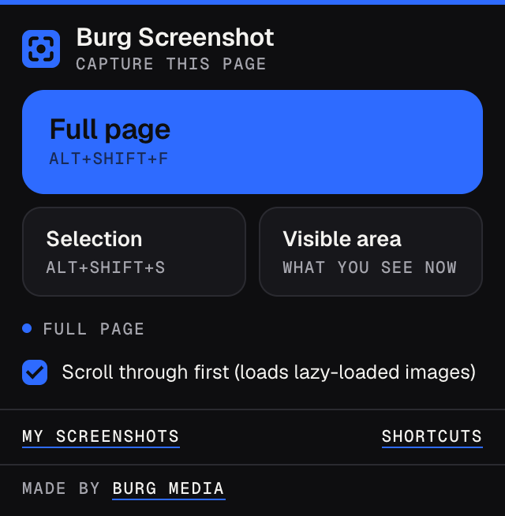
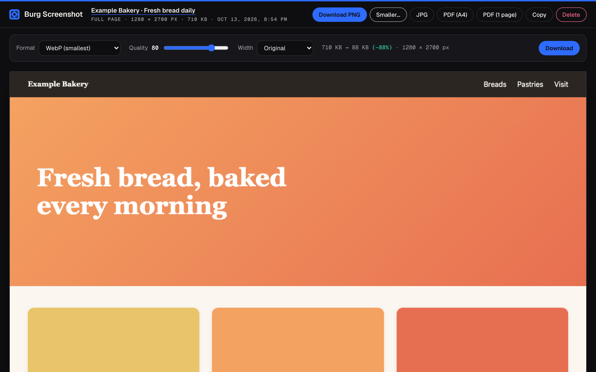
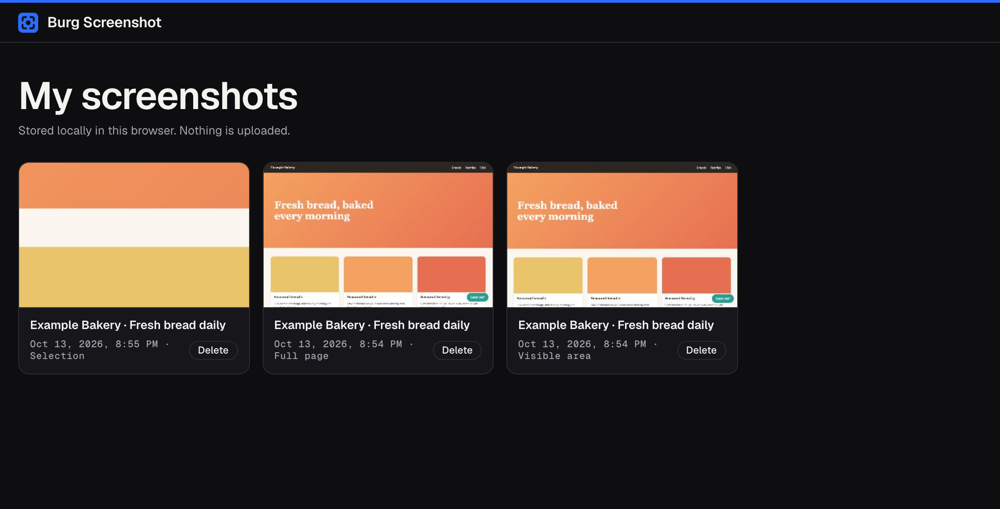

# Burg Screenshot

A Chrome extension that takes a screenshot of a full web page, a selection or the visible area, keeps it in your own browser and exports it as PNG, JPG, WebP or PDF.





## Features

- **Full page.** Scrolls the page from top to bottom and stitches the captures into one image. Sticky headers appear once, fixed elements (such as chat buttons) are only kept in the first capture, and scrollbars are hidden. The page is put back exactly as it was afterwards, including your scroll position.
- **Pages that scroll inside a box.** On app-like pages where only part of the screen scrolls (web apps, dashboards), it finds the scrolling area and captures that.
- **Lazy-loaded images.** Optionally scrolls through the page first (up to about 8 seconds) so images that load on scroll are on the screenshot. You can turn this off in the popup.
- **Selection.** Drag a rectangle over the part you want; the size is shown while you drag. Esc cancels.
- **Visible area.** Exactly what is on your screen now.
- **Sharp on retina screens.** The screenshot uses the device pixels of your screen.
- **Very long pages.** Pages taller than Chrome's canvas limit are saved in several parts. Pages longer than 60,000 pixels (usually infinite scrolling) are cut off, with a notice.
- **Export.** Download as PNG or JPG, as a PDF split over A4 pages (all parts included) or as one long PDF page.
- **Smaller.** Choose WebP or JPG, quality and maximum width, and see the new file size before you download.
- **Copy** the image to the clipboard.
- **My screenshots.** A library of your earlier screenshots, newest first, with thumbnails. Open or delete them there.
- **Keyboard shortcuts.** Alt+Shift+F for the full page, Alt+Shift+S for a selection. You can change them under `chrome://extensions/shortcuts`.
- **Progress on the icon.** The toolbar icon shows the progress as a percentage, or `!` with the reason when a capture fails.
- **English and Dutch** interface, following your browser language.



## Install from source (Developer mode)

The easiest way to install Burg Screenshot is the Chrome Web Store version, linked from the [Burg Screenshot page](https://burgmedia.eu/shop/burg-screenshot). That version updates automatically. If you prefer to run the code from this repository, it takes a minute:

1. **Download the code.** Click the green **Code** button on this page and choose **Download ZIP**, or download the zip from [Releases](../../releases). Unzip it.
2. **Open the extensions page.** Type `chrome://extensions` in the address bar and press Enter.
3. **Turn on Developer mode.** Use the **Developer mode** switch in the top right corner.
4. **Load the extension.** Click **Load unpacked** and choose the unzipped folder (the folder that contains `manifest.json`).
5. **Pin it.** Click the puzzle piece icon in the toolbar and pin Burg Screenshot, so the icon is always visible.

Good to know:

- **Other browsers.** This also works in other Chromium based browsers, such as Microsoft Edge (`edge://extensions`), Brave (`brave://extensions`) and Opera (`opera://extensions`). The steps are the same; the Developer mode switch may be in a different place on the page. Burg Screenshot needs version 116 or newer.
- **No automatic updates.** An extension loaded this way does not update itself. To update, download the new version, replace the folder and click the **Reload** icon on the Burg Screenshot card in `chrome://extensions`.
- **Developer mode notice.** Chrome may remind you that extensions in developer mode are running. That is normal for extensions you load yourself.
- **Local files.** To capture pages opened from your disk (`file://`), turn on **Allow access to file URLs** on the Burg Screenshot card in `chrome://extensions`.

## Check it yourself with your AI agent

The code is small, has no build step and is not minified, so you don't have to take our word for anything. Point your own AI agent (Claude Code, Cursor, Copilot, ChatGPT) at this folder and let it check.

```text
Audit this Chrome extension for security and privacy before I install it.
1. List every permission in manifest.json and whether the code actually needs it.
2. Find every network request (fetch, XMLHttpRequest, WebSocket, sendBeacon, image or
   script URLs, remote code) and tell me where data goes.
3. Check for remote code execution: eval, new Function, remotely loaded scripts.
4. Check what is stored (chrome.storage, IndexedDB, cookies) and whether anything
   leaves my browser.
5. Check content scripts: which sites they run on and what they read from pages.
6. Give a verdict: safe to install or not, with file and line references.
```

The fastest manual check, from inside the folder:

```sh
grep -rn "fetch\|XMLHttpRequest\|http" .
```

Besides this README you will find the burgmedia.eu links described below, one `fetch()` in `background.js` that turns the screenshot Chrome hands over (a `data:` URL, already in memory) into an image, the SVG namespace in `images/icon.svg` and the font license URLs in `fonts/`.

## Privacy and security

- **No account, no analytics, no tracking, no ads.**
- **No remote code.** All JavaScript is in this repository. There are no CDNs or external scripts, and the extension pages only allow scripts from the extension itself (`script-src 'self'` in `manifest.json`). The fonts (Geist and Geist Mono) are included in `fonts/`.
- **Nothing is uploaded.** The extension makes no requests to any server. The only `fetch()` in the code reads the `data:` URL returned by `chrome.tabs.captureVisibleTab`; that never leaves your computer.
- **Page access only when you ask.** Burg Screenshot touches a page only after you click the toolbar icon and choose an action, or press a shortcut, and only in that tab. There are no content scripts that run on every site.
- **What happens on the page during a capture.** For a full page, the extension scrolls the page, temporarily hides scrollbars and fixed elements and makes sticky elements scroll normally. Everything is restored afterwards. If "Scroll through first" is on, scrolling makes the website load its lazy-loaded images, the same as when you scroll yourself. For a selection, it shows an overlay in that tab until you release the mouse or press Esc. It does not read page text, forms or cookies.
- **Where screenshots are stored.** In IndexedDB of the extension (database `burg-screenshot`), only in this browser profile on your device: the full PNG image, a small JPEG thumbnail, the page title, the page address, the capture mode, the size and the date. Nothing is synced. You delete screenshots yourself under **My screenshots** or with **Delete** in the viewer; removing the extension deletes all of them. The `unlimitedStorage` permission is there so long full-page screenshots fit.
- **Settings.** `chrome.storage.local` holds one setting ("Scroll through first"). The viewer remembers your last "Smaller" choices (format, quality, width) in its own `localStorage`.
- **Exports and downloads.** PNG, JPG, WebP and PDF files are made in the viewer tab, in your browser. They are saved with a normal browser download (a `blob:` link), so Chrome puts them in your downloads folder or asks where to save, as set in Chrome. File names contain the site's host name and the date, for example `example.com_2026-10-13_20-54.png`. The extension has no `downloads` permission.
- **Clipboard.** **Copy** writes the PNG image to the clipboard. The clipboard is never read.
- **Link to the original page.** The page title at the top of the viewer is a link to the address you captured. It opens only when you click it.

What does go out, and when:

- **After installing**, a welcome page opens once on burgmedia.eu (`https://burgmedia.eu/extensies/burg-screenshot/welkom/`). **After removing** the extension, Chrome opens a short page there (`…/verwijderd/`). Both URLs carry only fixed labels (`utm_source=burg-screenshot&utm_medium=extension&utm_campaign=install` or `uninstall`). No settings, screenshots, identifiers or browsing data are added. It is a normal page visit, so burgmedia.eu sees what any website sees, such as your IP address and browser; the privacy policy of burgmedia.eu applies there.
- **"Made by Burg Media"** at the bottom of the popup is a link with the same kind of labels (`utm_campaign=popup`). It opens only when you click it.

Found a security problem? See [SECURITY.md](SECURITY.md).

## Why is this free?

Burg Media is a small web studio in the Netherlands. We build these tools for our own work and give them away: no ads, no premium tier, no data collection. If they are useful to you, that is the best introduction to what we do. We build websites, web apps and custom software: [burgmedia.eu](https://burgmedia.eu)

## Permissions explained

| Permission | Why Burg Screenshot needs it |
|---|---|
| `activeTab` | Gives temporary access to the current tab only, and only after you click the toolbar icon or press a shortcut. Needed to take the screenshot (`chrome.tabs.captureVisibleTab`) and to scroll the page for a full-page capture. No access to other tabs or sites. |
| `scripting` | Injects the bundled code into that tab: the script that measures, scrolls and restores the page for a full-page capture, the CSS that hides scrollbars during the capture, and the selection overlay. Only after your click or shortcut, and only code from this repository. |
| `storage` | Saves the "Scroll through first" setting locally (`chrome.storage.local`). |
| `unlimitedStorage` | Lets the screenshot library in IndexedDB grow beyond the normal storage quota, because full-page PNG images can be several megabytes each. The data stays on your device. |

There are no `host_permissions` and no content scripts in `manifest.json`: Burg Screenshot cannot read or change any website on its own. The `commands` entry in the manifest is the two keyboard shortcuts, not a permission.

## Alternatives

Looking for an alternative to GoFullPage, Awesome Screenshot or FireShot? Burg Screenshot does the everyday part of that work: a full-page screenshot that handles sticky headers and pages that scroll inside a box, a selection or the visible area, and export to PNG, JPG, WebP or PDF. It needs no account, keeps your screenshots in your own browser instead of a cloud service, asks for no access to your sites until you click, and the source is right here for you to read.

## License

[MIT](LICENSE), Copyright (c) 2026 Burg Media. Third-party components and their licenses are listed in [NOTICE.md](NOTICE.md).

Made by [Burg Media](https://burgmedia.eu).
